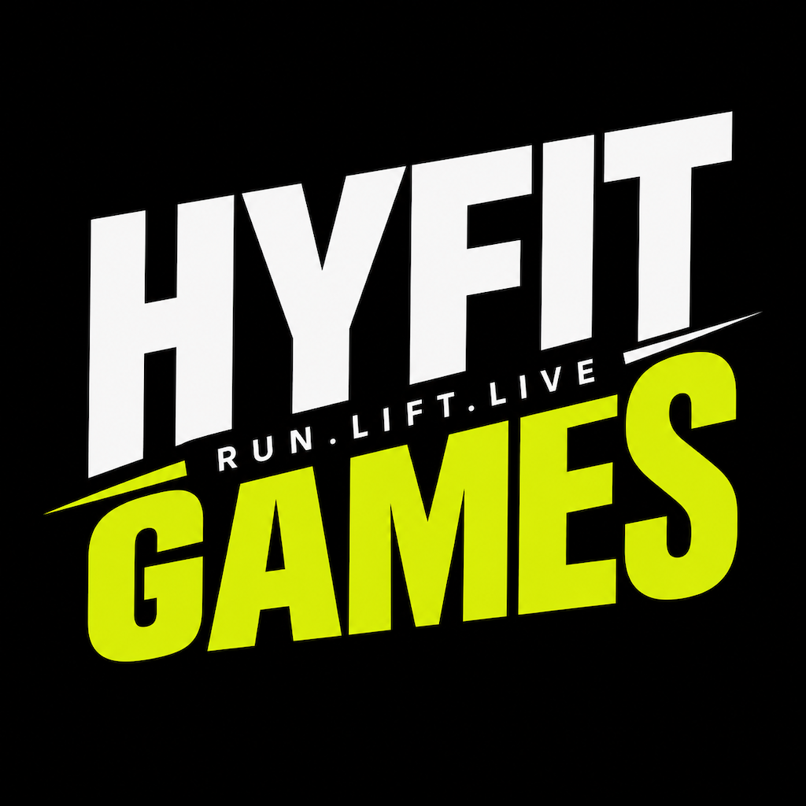

<div align="center">



# HYFIT Games

**Run. Lift. Live.**

An iOS race simulator for the HYFIT Games — simulate the race, know your performance.


</div>

---

## About

HYFIT Games is a hybrid fitness race: 200 m runs alternating with functional stations, bookended by a cognitive memory challenge. **HYFIT** lets you rehearse that race on your phone. Pick a race type and category, run through each segment with live timers, and review your splits, penalties and personal bests afterwards.

## Features

- **Race Setup** – choose a race type (Individuals, Doubles, Hyfit Games 2X) and one of 18 categories, edit the athlete and partner names, and pick the distance source (simulator or GPS).
- **Guided race flow** – cognitive start, alternating 200 m runs and work stations, cognitive recall, and a finish line, all timed.
- **Cognitive recall penalty** – recall accuracy after the race adjusts your final time.
- **Race history** – every completed race, grouped by month, with raw time, penalty and recall at a glance.
- **Stats** – best and average times, progress chart, personal bests, per-run and per-station splits, and cognitive performance.
- **Events** – upcoming, registration-open, coming-soon and past HYFIT Games races, with filters.
- **Profile** – set your name and profile photo; your avatar shows in the top-right of every tab.
- **Sora typography** and a dark, lime-accented design built with native iOS conventions.

## Race categories

| Race type | Categories |
|---|---|
| **Individuals** | NextGen (8–11), NextGen (12–15), Grand Masters (55–84), Open Male, Open Female, Pro Male, Pro Female |
| **Doubles** | Bloodline (parent + kid, 8–15), Male Doubles, Female Doubles, Mixed Doubles |
| **Hyfit Games 2X** | Open Male 2X, Open Female 2X, Pro Male 2X, Pro Female 2X, Male Doubles 2X, Female Doubles 2X, Mixed Doubles 2X |

> All categories currently share the Male Doubles race format (6 × 200 m runs, 6 stations, cognitive start and recall). Per-category values such as distances and loads will be added later.

## Race format

1. **Cognitive start** – memorise a colour sequence
2. **Run 1** → **Station 1** — Dumbbell Step-Ups
3. **Run 2** → **Station 2** — Farmers Carry
4. **Run 3** → **Station 3** — Bear Crawl
5. **Run 4** → **Station 4** — Burpees to Plate
6. **Run 5** → **Station 5** — Front Carry + Air Squats
7. **Run 6** → **Station 6** — Tyre Flips
8. **Cognitive recall** – repeat the sequence under fatigue
9. **Finish**

## Tech stack

- **Swift** & **SwiftUI**
- **SwiftData** for race result persistence
- **Core Location** for optional GPS distance tracking
- **PhotosUI** for profile photos
- Bundled **Sora** font family

## Getting started

**Requirements:** Xcode with the iOS 26.2 SDK or later.

```bash
git clone https://github.com/varunbuilds/Hyfit-Games.git
cd Hyfit-Games
open HYFIT.xcodeproj
```

Select the **HYFIT** scheme, choose an iOS simulator or device, and press **Run** (⌘R).

## Project structure

```
HYFIT/
├── App/            Navigation routes
├── Data/           Race definitions and catalog
├── Models/         Race, category, result and profile models
├── Persistence/    SwiftData storage
├── Services/       Distance tracking, stats, formatting, penalties
├── Theme/          Colours, Sora typography, shared UI components
├── ViewModels/     Race session state
└── Views/          Home, Race, History, Stats, Events, Profile, Setup
```

## Roadmap

- Per-category race formats (distances, loads, reps)
- City photos and online registration for events
- Richer race detail and sharing

## Credits

Typography: [Sora](https://github.com/sora-xor/sora-font) (SIL Open Font License).

---

<p align="center">Built with SwiftUI · <b>HYFIT Games</b></p>
